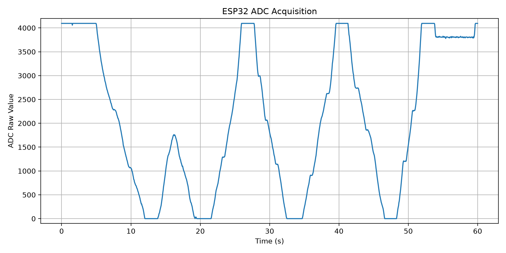
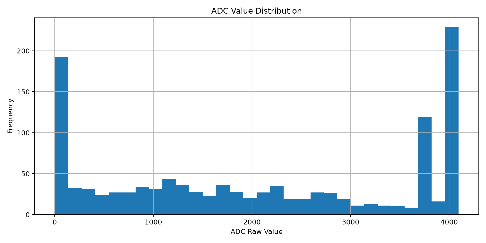

# ESP32 Analog Signal Acquisition and Data Analysis System

基于 ESP32 的模拟信号采集与数据分析系统。

## 1. 项目简介

本项目使用 ESP32-WROOM-32 开发板和 B10K 电位器，搭建了一套基础模拟信号采集系统。

通过 ESP32 ADC 模块读取模拟输入，使用 UART 串口将数据传输至 PC，再通过 Python 实现数据接收、处理、CSV 存储和可视化。

项目主要用于学习嵌入式开发、ADC 模数转换、串口通信和基础数据分析。

## 2. 系统架构

```text
B10K Potentiometer
        |
        v
ESP32 GPIO34
        |
        v
12-bit ADC Conversion
        |
        v
Timestamp + ADC Raw Data
        |
        v
UART Serial Communication
        |
        v
Python + PySerial
        |
        v
NumPy Data Analysis
        |
        v
CSV Storage + Matplotlib Visualization
```

## 3. 硬件配置

| Hardware | Specification |
|---|---|
| MCU | ESP32-WROOM-32 |
| Analog Input | GPIO34 |
| Potentiometer | B10K |
| ADC Resolution | 12-bit |
| ADC Range | 0–4095 |
| Sampling Interval | 50 ms |
| Sampling Frequency | 20 Hz |
| Serial Baud Rate | 115200 |

### 接线方式

| B10K | ESP32 |
|---|---|
| 外侧引脚1 | GND |
| 中间引脚 | GPIO34 |
| 外侧引脚2 | 3V3 |

## 4. 软件环境

- Arduino IDE
- Python 3
- PySerial
- NumPy
- Matplotlib
- Jupyter Notebook

安装 Python 依赖：

```bash
pip install pyserial numpy matplotlib
```

## 5. 项目功能

### ESP32 Firmware

- 12-bit ADC 配置
- ADC 输入衰减配置
- 软件定时采样
- 毫秒级时间戳
- UART 串口数据输出

### Python Data Acquisition

- 串口数据接收
- CSV 数据解析
- 异常数据过滤
- 数据统计
- 采样间隔分析
- ADC 量程覆盖率计算
- CSV 文件导出

### Data Visualization

使用 Matplotlib 生成：

1. ADC 动态采集曲线
2. ADC 数值分布直方图

## 6. 实验结果

### 60-second Continuous Acquisition

| Metric | Result |
|---|---:|
| Acquisition Duration | 60 s |
| Number of Samples | 1201 |
| Mean Sampling Interval | 50.0 ms |
| Minimum Interval | 50 ms |
| Maximum Interval | 50 ms |
| Average Sampling Frequency | 20.0 Hz |
| Timestamp Monotonicity | Passed |

### ADC Range Test

| Metric | Result |
|---|---:|
| ADC Minimum | 0 |
| ADC Maximum | 4095 |
| ADC Span | 4095 |
| Digital Range Coverage | 100% |

### Repeatability Test

三次早期全量程操作实验：

| Test | Minimum | Maximum | Coverage |
|---|---:|---:|---:|
| Test 1 | 0 | 4095 | 100% |
| Test 2 | 0 | 3831 | 93.55% |
| Test 3 | 0 | 4095 | 100% |

注：上述三次重复测试来自正式定时采样固件测试之前的实验，不应与后续60秒正式采样实验混为一组。

这些结果属于历史探索性实验，缺少原始 CSV，无法独立复核，不作为严格重复性测试的最终证据。保留原有汇总结果，不得伪造或补造原始数据。

## 7. Project Structure

```text
ESP32_Analog_Acquisition/
│
├── firmware/
│   └── ESP32_ADC_Timestamp/
│       └── ESP32_ADC_Timestamp.ino
│
├── python/
│   └── adc_acquisition.py
│
├── data/
│   ├── adc_60s.csv
│   ├── adc_60s_curve.png
│   ├── adc_distribution.png
│   └── runs/                         # 新实验运行时自动创建
│       └── run_YYYYMMDD_HHMMSS/      # 名称冲突时追加 _001、_002 等
│           ├── adc_60s.csv
│           ├── adc_60s_curve.png
│           └── adc_distribution.png
│
├── report/
│   └── test_report.md
│
└── README.md
```

## 8. How to Run

### Step 1: Upload Firmware

使用 Arduino IDE 打开：

`firmware/ESP32_ADC_Timestamp/ESP32_ADC_Timestamp.ino`

选择 ESP32 Dev Module，配置正确串口并上传。

### Step 2: Configure Python

根据实际设备修改：

```python
SERIAL_PORT = "COM6"
BAUD_RATE = 115200
CAPTURE_SECONDS = 60
```

### Step 3: Run Data Acquisition

```bash
python python/adc_acquisition.py
```

程序会自动接收数据、分析采样情况、保存 CSV 并生成图表。

程序不再使用 Tkinter 保存对话框。采集获得有效数据并完成统计后，自动在项目的 `data/runs/` 下创建独立实验目录，例如 `run_20261109_210000/`。目录名使用本机时间；同秒运行或已有同名文件/目录时，自动追加 `_001`、`_002` 等后缀，通过原子创建避免复用已有目录。

CSV 和两张 PNG 均保存到本次目录，控制台输出绝对保存路径；输出文件以独占创建模式写入，遇到已有文件会报错，不会覆盖。路径以脚本所在项目为基准，不受启动时工作目录影响。原始 `data/adc_60s.csv` 和两张图表保持原位。若写入失败，已生成的部分结果保留，不自动删除或覆盖。运行前关闭占用串口的 Arduino 串口监视器。

60 秒是 PC 端采集循环的目标时长，串口读取可能等待超时；每次实际样本数和设备时间跨度应以新采集数据为准。

### 实验文件与核验范围

- [原始 CSV](data/adc_60s.csv)
- [完整测试报告](report/test_report.md)





仓库中的正式 CSV 可复算得到 1201 条记录、60000 ms 时间跨度、全部相邻间隔 50 ms，以及 0–4095 的 ADC 范围。早期三次全量程操作测试仅保留汇总记录，`data/repeatability/` 暂无原始数据，无法独立复核；这些结果与正式 CSV 分开记录。

### 固件版本与测试状态

- 用户此前实际完成了编译、上传和 60 秒硬件采集，历史结果保留在原始 CSV 和测试报告中。
- Codex 检查了仓库固件：GPIO34、12 位 ADC、50 ms 软件调度、115200 波特率，与报告描述一致；本次未修改固件。
- 仓库只有首次发布时保存的固件，缺少与历史实验绑定的源码哈希、构建产物或上传日志。参数一致不能证明代码与当时实际烧录版本完全一致，当前固件标记为**待硬件复测**。
- 本次 Python 语法和离线输出检查属于软件验证，不代表重新编译、上传或完成真实串口采集。当前固件配合修改后 Python 程序的 60 秒端到端硬件复测尚未完成。

## 9. Limitations

当前项目主要验证基础模拟信号采集流程，尚未完成：

- ADC 精度和线性度测试
- 固定参考电压下的重复性测试
- 模拟前端滤波
- 运算放大器信号调理
- PCB 设计与实物测试

100% 数字量程覆盖率不代表 100% 测量精度。

当前20Hz采样使用软件定时调度，并非硬件定时器保证的严格等间隔采样。

## 10. Future Development

后续计划：

1. ADC 电压校准与精度测试
2. RC 低通滤波电路
3. 运算放大器信号调理
4. 单电源偏置电路
5. ESP32 闭环信号采集
6. PCB 设计与焊接测试
7. 光电传感器与 PPG 信号采集

## 11. Skills

- Embedded C/C++
- ESP32
- ADC Acquisition
- UART Communication
- Python
- PySerial
- NumPy
- Matplotlib
- CSV Data Processing

---

**Project Status: Basic ADC Acquisition and Continuous Sampling Validation Completed.**

**Author:** Personal Engineering Project

**Version:** V1.0
